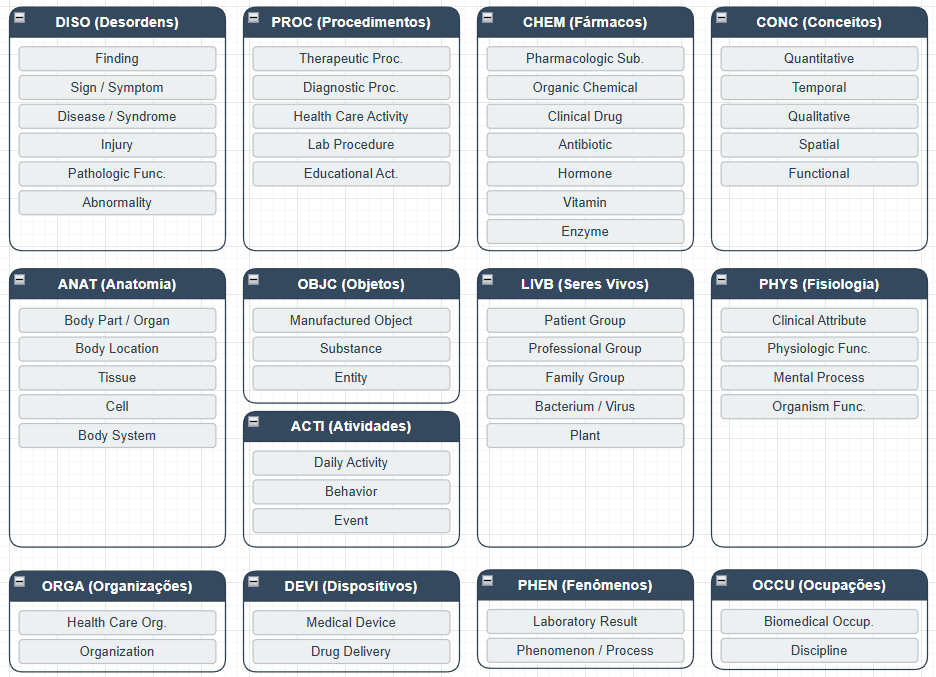
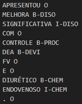

# NER clínico em português com LoRA

Trabalho de Conclusão de Curso em Ciência da Computação (UFES).

Este repositório compara 5 modelos BERT ajustados com **LoRA** para **reconhecimento de entidades nomeadas (NER)** em notas clínicas em português. As entidades seguem 13 grupos semânticos da UMLS (doenças, fármacos, anatomia, procedimentos e outros).

**Resultado principal:** o **BioBERTpt** teve o melhor desempenho em todas as divisões testadas: F1 de **0,600** no teste separado por documentos e F1 médio de **0,684 (±0,009)** em validação cruzada de 5 folds.

## Dados

- Corpus: **SemClinBr**, versão pública v1 em XML, com notas clínicas anotadas com tipos semânticos da UMLS ([Oliveira et al., 2022](https://doi.org/10.1186/s13326-022-00269-1)).
- O corpus **não está incluído** neste repositório. Para reproduzir, coloque a pasta `SemClinBr-xml-public-v1/` (com `train/`, `val/` e `test/`) na raiz.
- Os tipos semânticos (STY) de cada anotação são agrupados nos grupos abaixo. Quando uma anotação cai em mais de um grupo, vale a ordem de prioridade definida em `scripts/converter_para_bio.py`.



## Pré-processamento

`scripts/converter_para_bio.py` transforma os XMLs em arquivos no formato BIO:

1. Lê o texto e as anotações de cada XML e corrige os offsets de CRLF para LF.
2. Remove espaços nas pontas de cada anotação.
3. Tokeniza e separa sentenças com spaCy (`pt` em branco + `sentencizer`).
4. Resolve anotações sobrepostas com `filter_spans` e converte de BILUO para BIO.
5. Gera `dataset/grupos_sgr/train.bio`, `val.bio` e `test.bio`.

```bash
python scripts/converter_para_bio.py
```



## Modelos

| Modelo | Hugging Face |
| --- | --- |
| BioBERTpt | `pucpr/biobertpt-all` |
| BERTimbau base | `neuralmind/bert-base-portuguese-cased` |
| mBERT | `bert-base-multilingual-cased` |
| ClinicalBERT (inglês) | `medicalai/ClinicalBERT` |
| Albertina PT-BR 100M | `PORTULAN/albertina-100m-portuguese-ptbr-encoder` |

Configuração do LoRA (PEFT, tarefa `TOKEN_CLS`): `r=16`, `lora_alpha=16`, `lora_dropout=0.1`, módulos alvo `query` e `value` (`in_proj` na Albertina). A camada de classificação é treinada junto. Sequências de até 256 tokens, semente 42 e escolha do melhor checkpoint pelo F1 de entidade (seqeval).

## Experimentos

| Pasta | Divisão dos dados | Configuração |
| --- | --- | --- |
| `scripts/experimento-inicial/` | 60/20/20 por documentos | 10 épocas, lr 3e-5, batch 4 |
| `scripts/experimento-final/` | 80/20 por documentos (treino + validação contra teste) | 10 épocas, lr 3e-4, batch 16 |
| `scripts/kfold/` | 5 folds por sentença, sobre o corpus inteiro | 5 e 10 épocas, lr 3e-4, early stopping (paciência 2) |
| `experimentos/*_sem-ajuste/` | Modelo base sem ajuste fino | Referência |

Os notebooks rodam no Google Colab ou no Kaggle com GPU. Ajuste os caminhos dos arquivos `.bio` no início de cada notebook.

## Resultados

F1 de entidade (seqeval), ordenado pelo k-fold de 10 épocas:

| Modelo | 60/20/20 | 80/20 | k-fold, 5 épocas | k-fold, 10 épocas |
| --- | --- | --- | --- | --- |
| BioBERTpt | 0,537 | **0,600** | 0,637 ±0,010 | **0,684 ±0,009** |
| BERTimbau | 0,429 | 0,543 | 0,567 ±0,010 | 0,646 ±0,012 |
| mBERT | 0,351 | 0,498 | 0,516 ±0,011 | 0,610 ±0,013 |
| ClinicalBERT | 0,240 | 0,458 | 0,454 ±0,012 | 0,563 ±0,009 ¹ |
| Albertina PT-BR | 0,275 | 0,359 | 0,380 ±0,005 | 0,450 ±0,010 |

Sem ajuste fino, todos os modelos ficam entre 0,014 e 0,024 de F1.

¹ Esta rodada usou lr 3e-5. As demais rodadas de k-fold com 10 épocas usaram lr 3e-4 e batch 4; as de 5 épocas, batch 16.

F1 por categoria do BioBERTpt (k-fold, 10 épocas):

| Categoria | F1 |
| --- | --- |
| CHEM (fármacos) | 0,881 |
| LIVB (seres vivos) | 0,781 |
| DISO (desordens) | 0,723 |
| PHYS (fisiologia) | 0,663 |
| ANAT (anatomia) | 0,659 |
| PROC (procedimentos) | 0,638 |
| ORGA (organizações) | 0,632 |
| PHEN (fenômenos) | 0,625 |
| CONC (conceitos) | 0,608 |
| DEVI (dispositivos) | 0,317 |
| OBJC (objetos) | 0,130 |
| ACTI (atividades) | 0,092 |
| OCCU (ocupações) | 0,000 |

## Leitura dos resultados

- O modelo de domínio em português (BioBERTpt) vence em todas as divisões. O ClinicalBERT, treinado em inglês, fica abaixo de BioBERTpt, BERTimbau e mBERT em todas as divisões.
- Categorias com poucos exemplos (DEVI, OBJC, ACTI, OCCU) ficam bem abaixo das demais.
- O k-fold sorteia sentenças, então sentenças de um mesmo documento podem cair no treino e na validação. Por isso ele tende a ser otimista. A divisão 80/20 por documentos é a estimativa mais conservadora.
- Os hiperparâmetros não são idênticos em todas as rodadas (ver nota ¹).

## Estrutura

```
scripts/
  converter_para_bio.py      # XML do SemClinBr -> BIO
  experimento-inicial/       # notebooks 60/20/20
  experimento-final/         # notebooks 80/20
  kfold/                     # notebooks de validação cruzada
experimentos/
  <modelo>_<configuração>/   # relatórios (.txt, .json) e adaptadores LoRA
imagens/                     # mapeamento de grupos e exemplos de anotação
```

## Como reproduzir

1. Instale as dependências:

   ```bash
   pip install transformers datasets peft evaluate seqeval accelerate scikit-learn spacy
   ```

2. Coloque o corpus na raiz e rode `python scripts/converter_para_bio.py`.
3. Abra o notebook do experimento desejado no Colab ou no Kaggle, ajuste os caminhos e execute.

## Referência

Oliveira, L. E. S. et al. *SemClinBr – a multi-institutional and multi-specialty semantically annotated corpus for Portuguese clinical NLP tasks.* Journal of Biomedical Semantics 13, 13 (2022). https://doi.org/10.1186/s13326-022-00269-1

## Autor

Thiago Tonelli · [LinkedIn](https://www.linkedin.com/in/thiago-tonelli)
